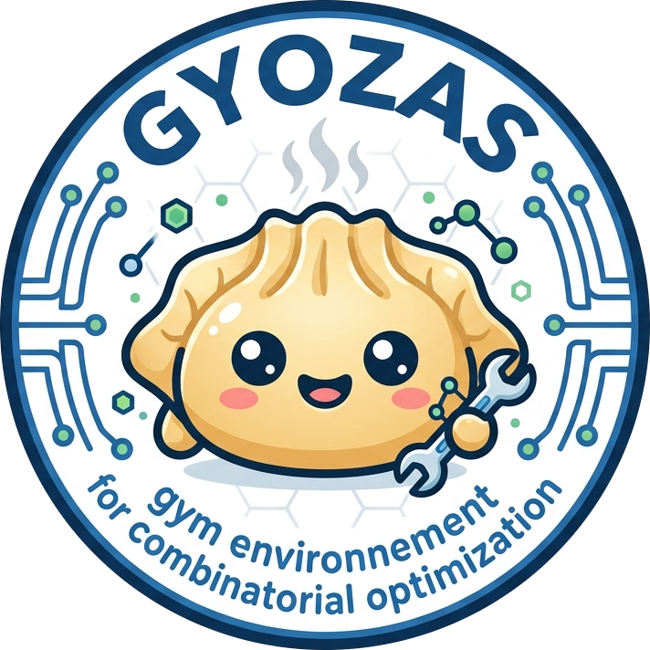

# Gyozas

<p align="center">
  
</p>

[](https://github.com/olivierjuan/gyozas/actions/workflows/ci.yml)
[](https://pypi.org/project/gyozas/)
[](https://pypi.org/project/gyozas/)
[](LICENSE)
[](https://codecov.io/gh/olivierjuan/gyozas)

A pure-Python reinforcement learning library for combinatorial optimization, built on top of [PySCIPOpt](https://github.com/scipopt/PySCIPOpt) and [Gymnasium](https://gymnasium.farama.org/).

Gyozas provides a modular RL environment that lets you train agents to make decisions inside SCIP's branch-and-bound solver -- variable selection (branching) and node selection -- with pluggable rewards, observations, and problem instance generators.

## Features

- **Gymnasium-style API** -- `reset()` / `step()` / `render()` interface
- **Branching & node selection dynamics** -- control variable branching or node selection decisions, or both jointly over typed decisions
- **Bipartite graph observations** -- LP-based features following [Gasse et al. (NeurIPS 2019)](https://arxiv.org/abs/1906.01629)
- **Pluggable branching experts** -- strong branching, SCIP's reliability pseudocost, Ecole-style pseudocosts
- **Fidelity profiles** -- activable per-method regimes (observation, expert, augmentation, training metadata) for reproducing each paper's protocol
- **Benchmark runner** -- config-driven grids (method × strate × seed), paired metrics, and rank statistics
- **Multiple reward functions** -- node count, solving time, LP iterations, primal/dual integrals, subtree sizes
- **Built-in instance generators** -- set cover, independent set, combinatorial auction, capacitated facility location, multiple knapsack
- **Branch-and-bound tree visualization**

## Prerequisites

Gyozas requires the [SCIP](https://www.scipopt.org/) solver (version 8+). But latest version should be installed when [PySCIPOpt](https://pyscipopt.readthedocs.io/en/latest/) is installed automatically with Gyozas dependencies

## Installation

```bash
pip install gyozas
```

Or install from source:

```bash
pip install .
```

You can install extra packages for enhanced visualization of branch and bound tree state using

```bash
pip install "gyozas[viz]"
```

## Quick Start

```python
import gyozas

# Create an instance generator
instances = gyozas.SetCoverGenerator(n_rows=100, n_cols=200)

# Create the RL environment
env = gyozas.Environment(
    instance_generator=instances,
    observation_function=gyozas.NodeBipartite(),
    reward_function=gyozas.NNodes(),
)

# Run one episode
obs, action_set, reward, done, info = env.reset()
while not done:
    action = action_set[0]  # pick first available action
    obs, action_set, reward, done, info = env.step(action)

env.close()
```

## Coming from Ecole?

Gyozas is a drop-in replacement for [Ecole](https://github.com/ds4dm/ecole) with a near-identical API:

| | Ecole | Gyozas |
|---|---|---|
| **Install** | C++ build, CMake, custom SCIP | `pip install gyozas` |
| **Language** | C++ core + Python bindings | Pure Python |
| **Maintained** | Last release 2023 | Active |
| **Python** | 3.7--3.10 | 3.10+ |
| **Custom components** | Subclass C++ base classes | Any object with `reset()`/`extract()` |
| **Node selection** | Not supported | `NodeSelectionDynamics` |
| **Gymnasium wrapper** | Not included | `GymnasiumWrapper` for SB3/CleanRL |

See the full [migration guide](https://olivierjuan.github.io/gyozas/migrating-from-ecole/) for detailed API mapping.

## Components

### Dynamics
- `BranchingDynamics` -- control variable selection in branching (default)
- `NodeSelectionDynamics` -- control which node to explore next
- `BranchingNodeSelectionDynamics` -- both jointly: typed `Decision` objects (branching vs node selection) over one episode
- `ConfiguringDynamics` -- single-step algorithm configuration (set SCIP params, then solve)
- `PrimalSearchDynamics` -- LP-probing primal heuristic; agent provides partial variable assignments
- `ExtraBranchingActions` -- sentinel actions (`SKIP`, `CUT_OFF`, `REDUCE_DOMAIN`) for branching

### Data Augmentation
- `ZarpellonAugmentation` -- the (s, k) exploration cells of [Zarpellon et al. (2021)](https://arxiv.org/abs/2006.06199): k random-explorer decisions before the expert's, seeded variable permutation

### Rewards
- `NNodes` -- change in number of explored nodes
- `SolvingTime` -- wall-clock time per step
- `LPIterations` -- change in LP iterations
- `DualIntegral` / `PrimalIntegral` / `PrimalDualIntegral` -- bound integrals
- `SubtreeSizes` -- subtree sizes, for Scavuzzo-style retrospective tree signals
- `RetroSearchTree` / `RetroBinaryFathomed` -- Parsonson's retrobranching rewards (terminal scores)
- `DifficultyAdaptive` -- the difficulty-adaptive hybrid rewards of Zarpellon et al. (2021)
- `Done` -- binary completion status
- `ArithmeticMixin` -- compose rewards with Python operators: `-NNodes() * 0.5 + SolvingTime().cumsum()`

### Observations
- `NodeBipartite` / `NodeBipartiteEcole` -- pure-Python bipartite graph with configurable features
- `NodeBipartiteSCIP` -- thin wrapper around PySCIPOpt's built-in C implementation
- `NodeBipartiteRetro` -- the bipartite graph plus the 24 retrospective features of Parsonson (2022)
- `NodeBipartitePlanBB` -- the retro observation with PlanB&B's deviations (single `is_best_sibling` flag, constant `branchability` slot), 43 variable features
- `BranchingStateObservation` -- the solver-stats triple (25+8+53) of Zarpellon (2021), reused by T-BranT and TGPPO
- `MetaObservation` -- stack observations (e.g. bipartite graph + branching state)
- `Pseudocosts` -- per-variable pseudocost scores accumulated across branching history
- `StrongBranchingScores` -- full and partial strong-branching scores via LP probing

### Experts
Branching experts for expert-driven data collection (imitation learning), all sharing one `select(model, action_set)` contract:
- `StrongBranchingExpert` -- full strong branching (the expensive, accurate track)
- `RelpscostExpert` -- SCIP's native reliability pseudocost score (the scalable track); exposes its full label vector via `scores()`
- `PseudocostExpert` -- Ecole-style locally-observed pseudocosts

### Fidelity Profiles
Each learn2branch paper's regime — observation, expert, augmentation grid, training metadata — is registered as an activable `FidelityProfile` (`gyozas.fidelity_profiles` defines them, `gyozas.fidelity` manages the registry): gasse, lookback, treegate, tbrant, mamba, tgppo, retrobranching, scavuzzo, sorrel, bbmdp, planbb, cambranch, dsccl, fmsts, seqbnb, plus the `gasse-relpscost` control arm (Gasse's protocol with the scalable expert, for pricing the expert switch). `register_fidelity_profile` / `get_fidelity_profile` / `available_fidelity_profiles` manage the registry.

### Benchmark Runner & Metrics
- `Runner` / `ExperimentConfig` / `Cell` / `Method` -- config-driven grids (method × strate × split × seed), records on disk, restartable (a re-run skips completed cells)
- `evaluate` -- a bare policy vs baseline experts over an instance set
- `metrics` -- the learn2branch pitfall-aware metric battery: `sgm_of_ratios` (Achterberg's shifted geometric mean of paired per-instance node ratios), `accuracy_at_1` against the multi-optimal record, `solved_vs_truncated`, `win_rate`, `quantiles` / `catastrophic_losses`, `friedman_nemenyi`, `wilcoxon_pair` / `wilcoxon_holm`, `summary_table`

### Reproducibility
- `SeedTriplet` -- one base seed fans out to solver / augmentation / python seeds
- `Strate` -- instance strates with frozen splits and signed manifests
- `ProtocolSnapshot` -- the frozen experiment protocol; campaigns check against it after the freeze
- `RunIdentity` -- every run record carries its full provenance
- `CollectionMetadata` -- the multi-optimal record (how many candidates tie the expert's best score), so acc@1 is never reported alone

### Instance Generators
- `SetCoverGenerator` -- random set cover problems
- `IndependentSetGenerator` -- random independent set problems
- `CombinatorialAuctionGenerator` -- random combinatorial auction problems
- `CapacitatedFacilityLocationGenerator` -- random facility location problems
- `MultipleKnapsackGenerator` -- random multiple knapsack problems
- `FileGenerator` -- load instances from files on disk

### Instance Modifiers
Modifiers wrap any generator and post-process the model before it reaches the environment:
- `EmbedObjective` -- embed the objective function as a variable + equality constraint
- `SetParameters` -- apply arbitrary SCIP parameters
- `SetNoCuts` / `SetNoHeuristics` / `SetNoDisplay` / `SetDFSNodeSelection` / `SetBFSNodeSelection` -- convenience presets

### Gymnasium Wrapper
`GymnasiumWrapper` exposes any `Environment` as a standard Gymnasium environment, compatible with Stable-Baselines3, CleanRL, and other RL frameworks.

## Tests

```bash
uv sync
uv run pytest
```

## Contributors

| Name | Affiliation | GitHub |
|------|-------------|--------|
| Olivier JUAN | EDF Lab | [@olivierjuan](https://github.com/olivierjuan) |
| Paul STRANG | EDF Lab · CNAM · ISAE | [@abfariah](https://github.com/abfariah) |

## License

[MIT](LICENSE)
